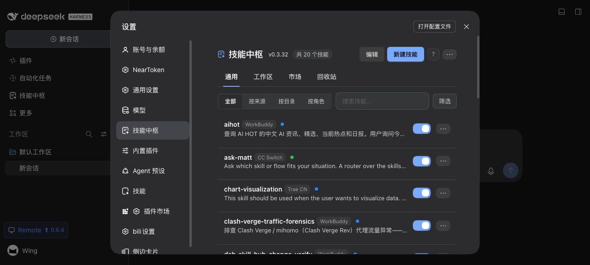

# dsh-skill-hub

[中文版](README.zh.md) | [English](README.md)

<p align="center">
  <a href="https://www.npmjs.com/package/dsh-skill-hub"></a>
  
  
  
</p>

<p align="center">
  
</p>

In-GUI skill hub for [DeepSeek Harness](https://github.com/deepseek-ai/deepseek-harness) — manage the full `ctx.skills` catalog from the Web GUI. Beyond browsing, toggling and market installs, it puts the weight on two things: **audit before install** (hidden control characters, encoding disguises and size caps are refused before they land; remote-execution pipes and credential paths are flagged for human review) and **budget after install** (the name + description characters of the first progressive-disclosure layer, so you learn at 8000 that a skill would install but never trigger).

> Host runs in the dsh process via official SDKs only; browser renders through official slots. No dsh source changes.

## Quick start

```bash
dsh plugin --profile web add dsh-skill-hub
# restart dsh web → Settings → Skills Hub → Market → scan → import
```

Requires `Node ^22.19 || >=24` + dsh web `>=0.1.7-alpha.1 <0.3`. dsh `0.2.2` and later require `Node >=24.9`.

Two surfaces — the hub panel lives at **Settings → Skills Hub**, and this plugin's own configuration card sits on the plugin's page in the **Plugins manager** (sidebar → 插件 → dsh-skill-hub). The card is registered by the plugin itself into the `plugins.bundle.config` slot — dsh has no auto-generated config page — and covers the master switch, announce-to-agent, dot colors, usage display and the stats window/interval.

## Features

**Settings → Skills Hub** — 4 tabs: **General** (all skills, viewed all / by source / by location / by role), **Workspace** (project skills for the selected workspace), **Market** (install + update), **Trash** (restorable removed skills).

The same hub is available as a **960px sidebar panel** (left rail → Plugins area → Skills Hub), so skills can be browsed without leaving the conversation.

- **Browse** — every root of the `ctx.skills` registry: project / user / bundled + third-party providers. Search across name, description, `displayName`; filter by source, status (enabled / disabled), and invocation (model / user); sort by name, added time, or usage. Every row has a `⋯` menu for detail / toggle / delete, so actions do not depend on edit mode. Same-name skills from different sources get a duplicate badge instead of silently hiding.
- **Content audit** — enabled skills' bodies (`SKILL.md`) are checked too: raw ESC control characters, Unicode tag characters, bidirectional controls, and encoding disguises (NUL bytes / UTF-16 / invalid UTF-8 in a text file) — these make "reviewed" not equal "seen" and are refused outright — plus zero-width characters, `curl … | sh` remote execution, SSH/cloud-credential/keychain paths, over-long descriptions, and the 2 MiB per-file / 10 MiB per-skill / 500-file limits. Only findings with no legitimate use block the install; the rest are warnings for a human to judge. Pure local static matching: no model call, no network. A market import scans the whole bundle (including `scripts/`); the standing check only reads `SKILL.md` — it runs on every 5-second poll, and walking every directory would slow the panel down.
- **Announcement budget** — the name + description total that the first progressive-disclosure layer injects comes back with the catalog, so the panel can show characters and an estimated token count; past 8000 characters it turns red (clients truncate the tail there, which shows up as "installed but never triggers").
- **Toggle** — per-skill switches and per-group tri-state switches with a conflict dialog (close all / keep on). Disabling is a sidecar policy: the discovery file is never renamed or deleted; an invocation override turns off model auto-invocation while `/name` keeps working. Paused skills stay in the catalog, are inspectable and re-enableable, and can be moved to trash from edit mode. Only `~/.dsh/skills` & `~/.agents/skills` are writable; everything else is read-only.
- **Organize** — three independent axes: **source** (the upstream repo a skill was installed from), **location** (the discovery root, e.g. `~/.dsh/skills` / `Codex`), and **roles** (user-curated skill sets). Source collections auto-aggregate; locations get their own **by location** view, one card per discovery root with a whole-root switch (when a skill is discovered in several roots, it belongs to the registry's winning root — the same one the row badge shows); roles are manual and drag-reorderable, and support **switch to role** — enable the members, pause every other switchable skill (the confirm dialog lists them so you can keep any of them on), with the previous switch states saved for a one-click restore. Skills not assigned to any role stay reachable from the collapsed "Unassigned" card. Role cards always show their full rosters and ignore the source/status filters (search and invocation still apply). Roles and source collections persist in `~/.dsh/dsh-skill-hub.json`; the restore snapshot lives in browser localStorage. Edit mode reveals delete/reorder without cluttering the read view.
- **Diagnose & fix** — files the provider skips (missing frontmatter, bad YAML, name mismatch, short description) show up with reasons; every entry is tagged **broken** (the provider skips the file, so the skill never appears in the list) or **warning** (it loads, but has an issue), the section header counts both levels, and broken rows are red; auto-fixable ones (e.g. unquoted `:` in descriptions) get a one-click Fix button.
- **Scaffold** — new-skill wizard writing to `~/.dsh/skills` or `~/.agents/skills` (`SKILL.md` template below).
- **Market** — built-in curated repos plus custom `owner/repo` sources. Any top-level directory containing `SKILL.md` scans as a root (no allowlist), and a `SKILL.md` at the repo root itself scans as a single skill named after the repo (minus repo tooling such as `.github/`). Async import with byte-level progress and cancel. Each source pins a version — click the ref badge to switch between releases, branches, or a custom ref. Every import passes the content audit first: a skill with a blocking finding is refused as a whole and its temp directory is removed (nothing left on disk).
- **skills.sh search** — beyond the built-in catalog, search the [skills.sh](https://skills.sh) index by skill name; results show the hosting repo and its install count, with two actions per row: **Install** pulls that one skill straight in (one step, but it does **not** track upstream — the index gives a skill directory name, never its path inside the repo, so no source record can be registered), while **Add source** registers the repo and scans it, after which update tracking, version pinning and trash behave exactly like a hand-added source. Both paths pass the same content audit. Requests are proxied server-side — the upstream sends no CORS headers, and a search should not hand the user's egress IP to a third party — and both `source` and package paths are validated against strict shapes before use.
- **Track updates** — imported skills record a repo + commit snapshot. Check all / update-all (covering both new releases and skill updates), per-source badges (installed / updatable / deleted upstream / new release). When a new release is out, **Update** re-pins to that release first and then syncs (pin the version badge by hand to stay on an older one). The sync dialog preselects only skills that actually changed upstream and marks locally edited ones before they are overwritten; upstream deletions move into a restorable trash that keeps source and role membership.
- **Local-edit detection** — a content hash of the whole skill (path + size + body) is sampled right after the bytes land and compared on every check: skills that no longer match get an "edited locally" badge, and the sync dialog marks exactly which ones the overwrite will discard. Records without a hash are treated as unknown, never as edited.
- **Import from another agent** — read-only scan of the skill folders of Claude Code / Codex / WorkBuddy / Cursor / Gemini CLI / Copilot / OpenCode / Goose, at two levels: **user-level** (`~/.claude/skills` and friends) into `~/.dsh/skills`, and **project-level** (`<projectRoot>/.claude/skills` and friends, project roots derived from registered workspaces) into that project's `.dsh/skills`. The originals are untouched; flat skills land as directory bundles; the same content audit and size caps apply. Symlinked folders resolving to the same file (cc-switch style central management) are merged into one row with an "also in" badge; WorkBuddy display metadata (`workbuddy.json` or `SKILL.md` frontmatter) maps onto the hub's display name / short description, and stale absolute paths in `_skillhub_meta.json` are stripped from the copy.
- **Project skill toggles** — project skills can be switched off via an **invocation override**: the hub registers its provider once more into every live agent's skill layer (nearer than the preset layer) and publishes a same-name entry that outranks the host's native one, flipping that skill's `modelInvocable` to false. The model stops auto-invoking it, "/name" keeps working, and **not a single byte of the project changes** (zero git pollution). The state lives in the hub's sidecar; flipping the switch again restores it.
- **Import from ZIP** — pick a `.zip`: every directory containing a `SKILL.md` becomes one skill, so a single-skill archive and a collection both work, each passing the content audit independently. Before anything is unpacked the reader rejects path traversal, symlinks, encrypted and ZIP64 archives, and decompression bombs; writes go through a temp directory plus an atomic rename, so a failure leaves nothing behind. A name that is already enabled is skipped — only a disabled placeholder or an empty shell steps aside into the restorable trash.
- **Stats** — per-skill call counts + last-used times from session logs (incremental cache), group summaries; window and scan interval live-configurable from the settings card.
- **Settings card** — registered on the plugin's own page in the **Plugins manager** (sidebar → 插件 → dsh-skill-hub; collapsed until you expand the title): master switch, announce-to-agent, invocation dot colors, usage display toggles, stats window/interval.

## Content audit and announcement budget

| Capability | What it does |
| --- | --- |
| Content audit | Raw ESC / Unicode tag characters / bidirectional controls / zero-width characters / `curl … \| sh` / SSH and cloud credential paths / 2 MiB per file, 10 MiB per skill, 500 files. Blocking (refuses the write; a market import is refused as a whole and its temp directory removed): raw ESC / Unicode tags / bidirectional controls / encoding disguises / size caps. Warnings (flagged, not blocked — these have legitimate uses): zero-width characters, `curl … \| sh`, credential paths, over-long description. Pure local static matching: no network, no model call. |
| Announcement budget | The name + description total of the first progressive-disclosure layer comes back with the catalog, so the panel shows characters and an estimated token count; past 8000 it turns red — clients truncate the tail there, which shows up as "installed but never triggers". |

Scaffold format (`SKILL.md`):

```markdown
---
name: my-skill
description: One line when the agent should use this skill.
---
# my-skill
Body...
```

## How it works

```text
GitHub repo ──scan/import──▶ ~/.dsh/skills
     ▲                          │
     └─check/sync/delete── ctx.skills ◀─ provider
                                │ snapshot/get
                                ▼
                    /api/skill-hub/* ──▶ Panel (Settings → Skills Hub)
```

Host uses only `ctx.skills.snapshot/get`, `ctx.webServer.register`, `ctx.systemPrompt.section`. Routes sit behind dsh's own `/api` trust fence (loopback / the listener's bind address / `--trusted-host`), JSON; **write routes (POST) additionally require an `x-dsh-skill-hub: 1` header** — a cross-site page cannot forge a custom header, and a same-origin request skips the CORS preflight so it costs no extra round trip. The provider registers in the global skill layer and once more into every live agent's skill layer (nearer than the preset layer), so an invocation override can outrank the host's native entries.

## HTTP API

| Endpoint | Method | Purpose |
| --- | --- | --- |
| `/api/skill-hub/catalog?cwd=` | GET | skills + disabled + diagnostics + duplicates |
| `/api/skill-hub/skill?name=&cwd=` | GET | skill body (works for disabled too) |
| `/api/skill-hub/skill/delete` | POST | move to trash (snapshots source+roles) |
| `/api/skill-hub/toggle` | POST | `{name, enabled}` |
| `/api/skill-hub/toggle-batch` | POST | `{names, enabled}` |
| `/api/skill-hub/create` | POST | `{name, description?, root?}` |
| `/api/skill-hub/diagnostic/fix` | POST | `{path}` auto-fix frontmatter |
| `/api/skill-hub/stats` | GET | invocation counts |
| `/api/skill-hub/config` | GET/POST | runtime config (`null` clears) |
| `/api/skill-hub/groups` | GET | tags + collections + orders |
| `/api/skill-hub/tag` etc. | POST | create/rename, delete, set members, reorder |
| `/api/skill-hub/market` etc. | GET/POST | list/add/delete/pin sources; `…/source/check` + `…/source/sync` update them |
| `/api/skill-hub/market/source/versions?repo=` | GET | releases + branches for the version picker |
| `/api/skill-hub/market/skills-sh?q=` | GET | skills.sh index search (server-side proxy, ≥2 chars; results validated as strict `owner/repo`) |
| `/api/skill-hub/market/skills-sh/install` | POST | `{source, skillId}` installs one skill directly (no source record, so no update tracking) |
| `/api/skill-hub/repo?repo=` | GET | discover (any root) |
| `/api/skill-hub/repo/import` | POST | async job `{jobId, total, totalBytes}` |
| `/api/skill-hub/repo/import/progress?jobId=` | GET | poll job |
| `/api/skill-hub/repo/import/cancel` | POST | cancel job |
| `/api/skill-hub/sources` etc. | GET/POST | list/check/sync/delete/restore/clear trash |
| `/api/skill-hub/foreign` | GET | read-only scan of other agents' skill folders (user-level + project-level; project roots derived from registered workspaces) |
| `/api/skill-hub/foreign/import` | POST | `{items:[{agent,name,scope?,projectRoot?}]}` copied into `~/.dsh/skills` (user-level) or that project's `.dsh/skills` (project-level) |
| `/api/skill-hub/import/zip` | POST | raw `.zip` bytes (`content-type: application/zip`, ≤32 MiB); every directory holding a `SKILL.md` becomes one skill, audited and installed independently |
| `/api/skill-hub/update` | GET | plugin latest release |
| unknown `/api/skill-hub/*` | GET/POST | `404 {error}` naming the path — a typo must not read as an auth failure (the SPA fallback answers 401 for `/api/*` it does not own) |

## Development

```bash
npm run typecheck  # tsc --noEmit
npm test           # 543 tests, 26 suites
npm run build      # tsc + tsdown → lib/index.js + lib/client.js
```

> Don't run two `dsh web` on the same `$DSH_HOME` + cwd — no session-log lock (`seq gap` corruption). Use separate `DSH_HOME`.

## Troubleshooting

- `duplicate loader entry id: skill-hub` — remove the duplicate install (keep one `dsh plugin add` method).
- Skill missing — check the diagnostics section (frontmatter / name mismatch / short description / two discovery forms claiming the same name: a `<name>/SKILL.md` bundle and a `<name>.md` file can coexist on disk, and the registry keeps only one of them).
- Empty source group — its skills were deleted, or their paused records were lost (sidecar restored/hand-edited). Startup first migrates any legacy `.disabled` file into a policy override, then reconciles records **and prunes records whose file is gone**. Source groups with no visible member are no longer rendered.
- A skill cannot be created / stays "paused" — the paused record pointed at a file that no longer exists. Startup drops the stale record so the name is free again; enabling a paused skill simply clears the override and the record.
- Dots missing in `/` menu — dsh internals changed; catalog still works.
- Settings card missing — open the plugin in the Plugins manager (sidebar → 插件 → dsh-skill-hub) and expand the 「技能中枢」 card at the top of the page (collapsed by default). On dsh older than `0.1.7-alpha.1` this plugin does not load at all (the settings API it targets does not exist there).

## Community

[Issues](https://github.com/cheshireez/dsh-skill-hub/issues) · [Discussions](https://github.com/cheshireez/dsh-skill-hub/discussions) · [Showcase](https://github.com/deepseek-ai/deepseek-harness/discussions/3161) · [Market PR](https://github.com/awesome-dsh-plugin/awesome-dsh-plugin/pull/1746) · [Discord](https://discord.gg/Ycq5dCaS4)

## License

MIT — [LICENSE](LICENSE).
